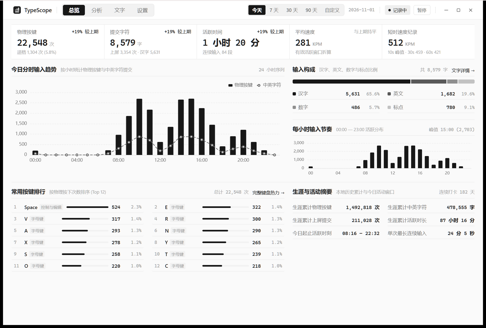
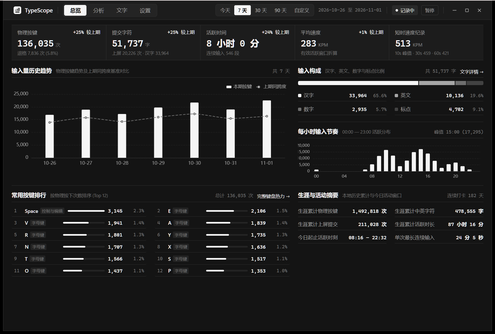
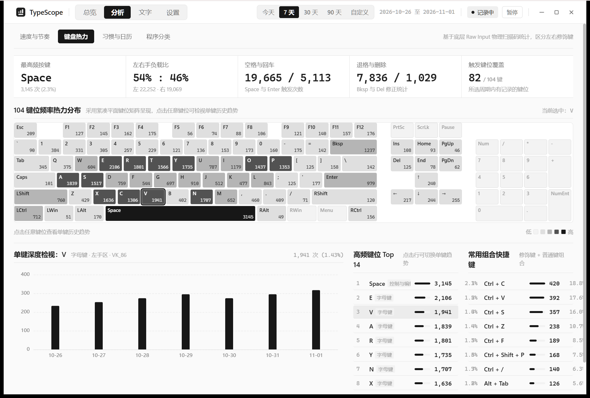
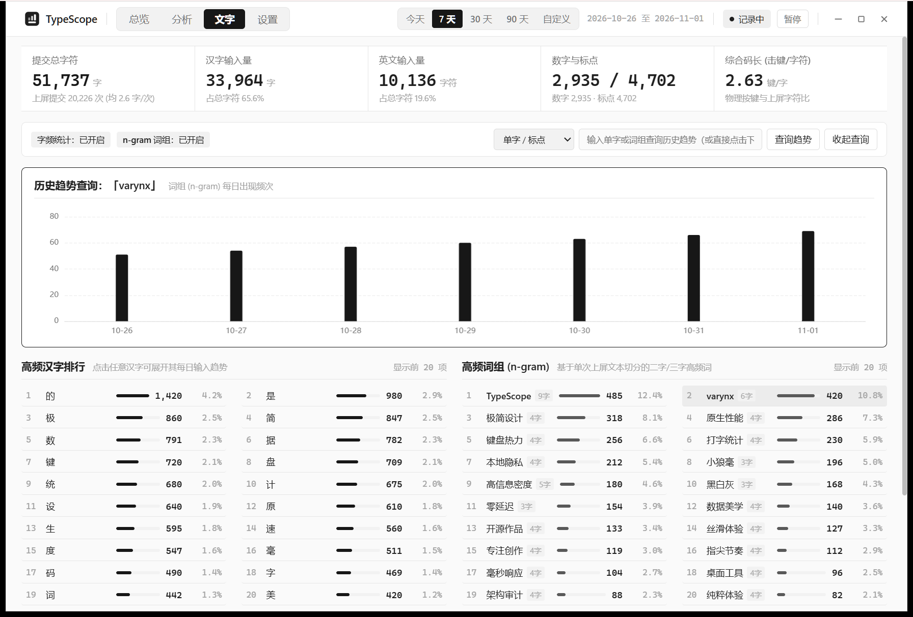
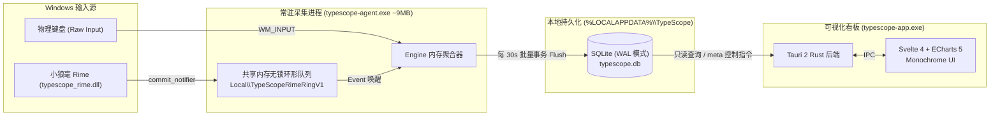

<div align="center">
  
  <h1>TypeScope</h1>
  <p><strong>Windows 原生极简打字统计与输入行为分析工具</strong></p>
  <p>
    <code>Raw Input 底层采集</code> · <code>Monochrome 极简看板</code> · <code>100% 本地 SQLite 存储</code> · <code>常驻内存 ~9 MB / 0% 空闲 CPU</code>
  </p>
  <p>Created by <strong>varynx</strong></p>
</div>

---

## 项目简介

**TypeScope** 是一款专为 Windows 11 打造的本地打字统计与输入分析桌面软件。它采用 **双进程分离架构**：

- **后台采集引擎（`typescope-agent.exe`）**：基于原生 Win32 `Raw Input` 消息循环与共享内存无锁环形缓冲区（`Local\TypeScopeRimeRingV1`），常驻系统托盘，工作集内存仅 **~9.1 MB**、空闲 CPU 占用 **0.0%**，关闭看板窗口不影响后台记录。
- **可视化分析看板（`typescope-app.exe`）**：基于 **Tauri 2 + Svelte 4 + ECharts 5** 构建，采用 **Monochrome 黑白灰单色设计体系**（支持浅色 / 深色 / 跟随系统），提供高信息密度的分时趋势、104 键位热力矩阵、短时爆发速度纪录、26 周打卡日历与高频字词分析。

所有数据 **100% 存储在本地 `%LOCALAPPDATA%\TypeScope\typescope.db`**，零网络请求、不保存连续原文句子、不读取窗口标题。

---

## 界面预览

### 总览看板（浅色模式 & 深色模式）

| 浅色模式（Light Mode） | 深色模式（Dark Mode） |
| :---: | :---: |
|  |  |

### 深度分析与文字统计

| 104 键键盘热力与单键历史趋势 | 速度纪录与按键间隔分布（IKI） |
| :---: | :---: |
|  |  |
| **26 周打卡日历与 7×24 小时时段矩阵** | **文字构成、高频汉字与 n-gram 词组统计** |
|  |  |

---

## 核心特性

### 1. 严密的“物理按键”与“上屏文字”双轨统计
普通键盘统计工具无法区分拼音输入过程中的编码按键与最终上屏汉字。TypeScope 将二者严格解耦：
- 例如使用小狼毫输入 `nihao` 并按空格上屏「你好」：
  - **物理按键** 记 6 次（仅统计真实物理按下，自动剔除长按连发 `RI_KEY_REPEAT` 与软件模拟注入按键 `IMO_INJECTED`）。
  - **提交汉字** 记 2 字，**上屏提交** 记 1 次。
  - **拼音编码 `nihao` 绝不会被误计为 5 个英文字母**。

### 2. 防虚高的真实打字速度算法
- **有效活跃时长（Active Time）**：仅累加相邻两次物理按键间隔不超过空闲阈值（默认 `5 秒`，可在设置中调整为 `3s ~ 15s`）的时间差；停顿思考时间不计入分母。
- **平均速度（KPM）**：按 $\text{round}(\text{物理按键} \times 60000 / \text{有效活跃毫秒})$ 计算。
- **10 秒 / 30 秒 / 60 秒峰值速度纪录**：固定以完整时间窗口（10s / 30s / 60s）为分母，且要求窗口内至少包含 20 次击键并覆盖半数以上窗口跨度，彻底杜绝敲击两三下产生数千 KPM 的虚高噪音。

### 3. 零配置跨机器适配与小狼毫（Weasel / Rime）一键集成
- **即开即记**：首次双击打开 `typescope-app.exe` 时，会自动拉起同目录下的后台采集服务 `typescope-agent.exe` 并立即开始记录物理按键，所有路径均动态解析，不依赖固定安装位置。
- **自动识别任意小狼毫路径与输入方案**：
  - 自动从注册表读取用户自定义的 `RimeUserDir` 与 `WeaselRoot` 安装位置。
  - 自动探测用户正在使用的输入方案（原生支持 **薄荷拼音 `rime_mint`、雾凇拼音 `rime_ice`、朙月拼音 `luna_pinyin`、小鹤双拼、万象拼音** 等所有 Rime 方案）。
  - 可直接在软件 **「设置 -> 小狼毫 (Rime) 上屏通道 -> 一键接入小狼毫」** 按钮完成配置与自动部署，无需手动修改 YAML。

### 4. 隐私与安全设计
- **打散存储，无法还原原文**：高频字词统计默认关闭；开启后也仅在内存中将单次上屏文本拆散为独立单字与 2~3 字 n-gram 词组并累加当日频次，共享内存槽位读取后立即清零（`slot.data.fill(0)`）。
- **敏感串与密码管理器过滤**：长度 $\ge 8$ 的纯 ASCII 字母数字混合串（疑似密码/Token）自动跳过字词统计；支持通过 `exclude.txt` 排除 KeePass、1Password、Bitwarden 等任意指定进程。

---

## 系统架构



---

## 快速开始

### 方式一：直接下载免安装版（推荐）

前往 [GitHub Releases](https://github.com/YxY09/TypeScope/releases) 下载最新版的 **`TypeScope-windows-x64.zip`** 并解压到任意文件夹（包内已包含 `typescope-app.exe`、`typescope-agent.exe`、`typescope_rime.dll` 与 `rime\` 脚本）：

1. 双击运行 **`typescope-app.exe`**，后台采集进程会自动启动并在系统托盘常驻。
2. 如需统计中文上屏字数与高频字词，进入软件 **「设置」** 页面，点击 **「一键接入小狼毫」**（或运行 `.\rime\install.ps1 -Deploy`），即可自动完成小狼毫插件挂载与重新部署。

### 方式二：从源码编译

**环境要求**：
- Windows 10 / 11 (64-bit)
- Rust 工具链（`stable-x86_64-pc-windows-msvc`）
- Node.js 18+ 与 npm

```powershell
# 1. 构建前端静态资源（内嵌至 Tauri 二进制）
npm --prefix app install
npm --prefix app run build

# 2. 运行全工作区单元测试与 Clippy 静态检查
cargo test --workspace
cargo clippy --workspace --all-targets

# 3. 编译 Release 发布版可执行文件与 Rime 插件 DLL
cargo build --release --workspace
```

编译产物位于 `target\release\`：
- `target\release\typescope-app.exe`
- `target\release\typescope-agent.exe`
- `target\release\typescope_rime.dll`

---

## 命令行辅助工具

`typescope-agent.exe` 提供以下无需界面的命令行参数：

```powershell
# 自检数据库、共享内存与 Raw Input 注册能力（结果写入 %LOCALAPPDATA%\TypeScope\check.txt）
.\target\release\typescope-agent.exe --check

# 安全退出后台采集进程（自动落盘未刷写数据、截断 WAL 并卸载键盘监听）
.\target\release\typescope-agent.exe --quit

# 写入 / 移除当前用户开机自启（HKCU\...\Run，无需管理员权限）
.\target\release\typescope-agent.exe --install-autostart
.\target\release\typescope-agent.exe --remove-autostart
```

小狼毫脚本工具（位于 `rime\` 目录）：

```powershell
# 自动探测小狼毫目录与当前输入方案，安装插件并触发重新部署
.\rime\install.ps1 -Deploy

# 卸载小狼毫插件并恢复配置
.\rime\uninstall.ps1 -Deploy
```

---

## 资源占用表现

| 进程名称 | 常驻工作集内存 (Working Set) | 私有提交内存 (Private) | 系统句柄 / GDI / USER | 空闲 CPU 占用 |
| :--- | :--- | :--- | :--- | :--- |
| **`typescope-agent.exe`**（后台常驻） | **~9.1 MB** | **~1.6 MB** | 159 / 7 / 4 | **0.0%** |
| **`typescope-app.exe`**（仅打开看板时运行） | **~23.5 MB** | **~6.0 MB** | 306 / 13 / 26 | **0.0%** |

